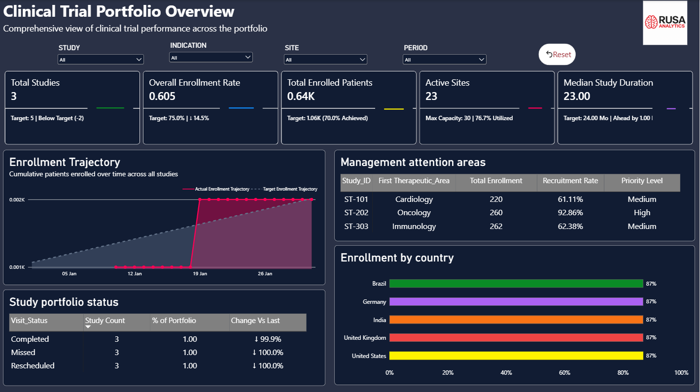
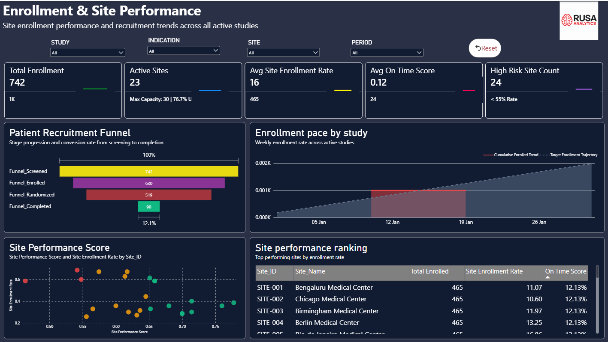
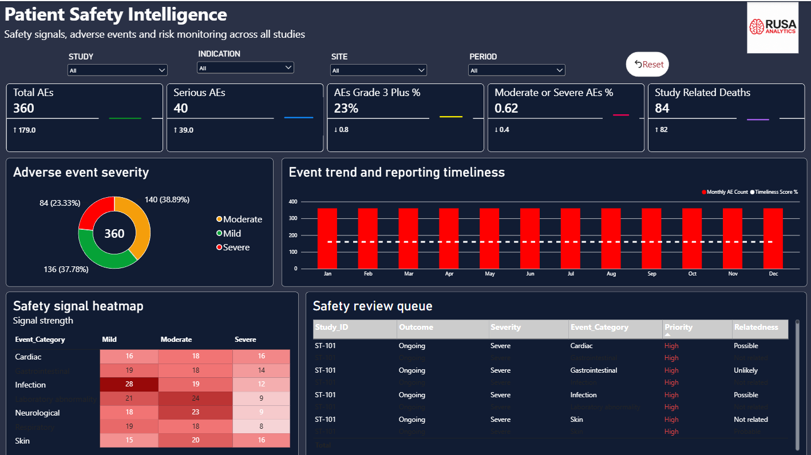
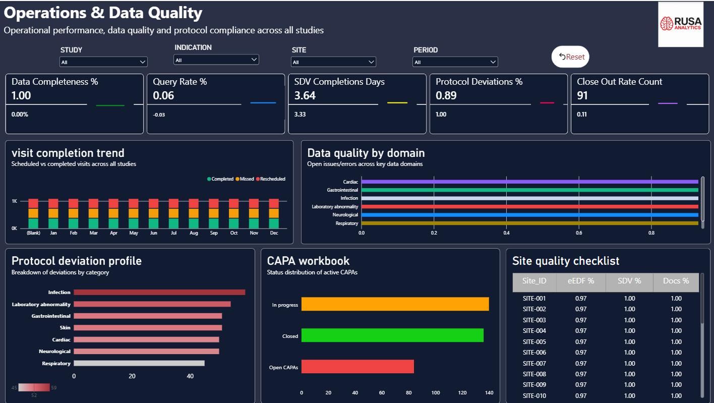

# Clinical Trial Intelligence | RUSA Analytics

**Healthcare analytics portfolio • Microsoft Power BI • Synthetic demonstration data**

A four-page Power BI showcase for clinical trial portfolio monitoring, site recruitment, safety signals, and operational data quality. These are actual screenshots from the RUSA Analytics dashboard.

## Dashboard gallery

### Clinical Trial Portfolio Overview

### Enrollment & Site Performance

### Patient Safety Intelligence

### Operations & Data Quality

## Business use cases

- Cross-study portfolio monitoring and management attention areas
- Enrollment pace, recruitment funnel and site ranking
- Adverse event trends and safety review queues
- Protocol deviations, CAPA and quality monitoring

## Technology

Power BI and a synthetic Excel data source; filtering by study, indication, site, and period.

## Publication policy

**Synthetic data only.** Figures are illustrative and do not represent real patient outcomes, clinical findings, or validated client deployments. Figures are illustrative and have not been validated as clinical or business results.

The Power BI file (.pbix) and source data are not published in this repository.

**RUSA Analytics** | [GitHub organization](https://github.com/RUSA-Analytics)
